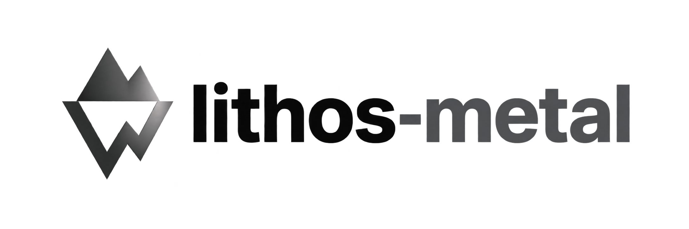

<h1 align="center">
  <picture>
    <source media="(prefers-color-scheme: dark)" srcset="assets/branding/lithos-metal-logo-dark.png">
    
  </picture>
</h1>

**lithos-metal is a fully open-source inference engine that generates Metal megakernels for Apple silicon.**
It brings low-latency LLM inference to your Mac, with local serving for coding agents and other applications.
The engine combines **layer-wise mixer megakernels**, **GPU-resident generation control**, and **DSpark
speculative decoding** to reduce execution overhead and make better use of each target-model pass.

[Quick start](#quick-start) · [How it works](#how-it-works) · [Performance](#performance) · [Documentation](#documentation)

## Quick start

Use an Apple silicon Mac with **macOS 26+**, a registered chip backend, and enough unified memory for the
target model, draft model, and context. The Qwen3.8-27B and Qwen3.6-35B-A3B configurations have been exercised
on a **40-core M5 Max with 48 GB of unified memory**. See [hardware support](#models-and-hardware) for other backends.

Install the precompiled package from the [Lithos Homebrew tap](https://github.com/lithos-ai/homebrew-tap):

```bash
brew install lithos-ai/tap/lithos-metal
lithos-metal serve --model nvidia/Qwen3.8-27B-NVFP4
```

The server downloads the target and its matching **LithosAI NVFP4 DSpark head**, prepares cached weight packs,
and selects the device's kernel recipes. Startup includes compilation and warmup. By default, DSpark proposes
seven tokens, which the target verifies together with one anchor token. Use `--no-draft` for target-only
generation or `--draft PATH_OR_HUB_ID` to select another DSpark checkpoint.

The default endpoint is `http://127.0.0.1:8000`, with a 32K context capacity. Use `--max-context` to adjust
capacity to the model and available memory. Run `lithos-metal serve --help` for all options.

### Quantized KV cache

Select target-model K/V storage independently of weight quantization:

```bash
lithos-metal serve --model PATH_OR_HUB_ID --kv-cache-dtype q8_0
lithos-metal serve --model PATH_OR_HUB_ID --kv-cache-dtype q4_0
lithos-metal serve --model PATH_OR_HUB_ID --kv-cache-dtype turbo4
```

K and V can also use different formats:

```bash
lithos-metal serve --model nvidia/Qwen3.8-27B-NVFP4 \
  --k-cache-dtype q8_0 --v-cache-dtype q4_0 --max-context 32768
```

Each side accepts `bf16`, `q8_0`, `q4_0` or `turbo4`. `--kv-cache-dtype` sets the
shared default; a side-specific option overrides only that side, regardless of
argument order. For example, `--kv-cache-dtype turbo4 --k-cache-dtype q8_0` means
K=Q8_0 and V=Turbo4. Omitting all three options keeps BF16 for both.

BF16 remains the default. Q8_0 stores 32 values in 34 bytes (53.125% of BF16 KV storage);
Q4_0 stores 32 values in 18 bytes (28.125%). Turbo4 stores 128 values in 66 bytes (25.78125%). These ratios cover the target attention cache,
not weights, workspaces, recurrent state or the draft cache. Q8_0 and Q4_0 require head dimensions divisible
by 32; Turbo4 requires divisibility by 128. Unsupported shapes fail before allocation.

All three quantized modes support prefill, decode and prefix snapshots through the general attention kernels.
M6 accelerates qualified long-context prefill with matrix attention for BF16, Q8_0 and Turbo4.
See the [M6 matrix attention measurements](docs/research/m6-mma-prefill-20261014.md)
for dispatch thresholds, repeated prefill/decode results and numerical deviations.
Q4_0, mixed KV formats and decode retain the existing attention path. Quantized target caches bypass
BF16 direct-cache MMA/decoder recipes; `--kernel-config` is incompatible.
Draft KV and recurrent state retain their original precision. Turbo4 attention runs in the rotated
domain without reconstructing historical BF16 K/V.

On a 32 GB Apple M6, Qwen3.8-27B-NVFP4 with DSpark supports up to 64K with Turbo4 or Q4_0:

```bash
lithos-metal serve --model nvidia/Qwen3.8-27B-NVFP4 --kv-cache-dtype turbo4 --max-context 65536
```

Use `--kv-cache-dtype q4_0` in the command above to select standard ggml Q4_0 instead.
The default `auto-exact` prefill setting selects 128 rows through 32K and 32 rows above 32K.
At 64K, explicit prefill sizes other than 32 are rejected. These smaller dynamic passes do not
promise bitwise equivalence to 128-row passes. Above 8K, the M6 Turbo4/Q4_0 serving policy disables
host/disk prefix snapshots to leave memory for live model state; `--prefix-cache-dir` is incompatible.
Existing packs must cover the requested context plus DSpark's extra positions; omit `--pack` to
build/reuse a compatible cache automatically. BF16 remains the default, including its existing
M6 DSpark 8K context limit. Measured throughput and numerical deviations are recorded below;
general long-context model quality has not been established.
On M6 with DSpark, the capacity policy uses both formats: two 4-bit caches permit
64K; Q8_0 paired with Q4_0/Turbo4 permits 32K. Combinations containing BF16 and
symmetric Q8_0 retain the existing 8K limit. Long-context combinations disable
prefix snapshots as described above.
See [KV cache formats and limitations](docs/design/kv-quantization.md).

### Connect a coding agent

Leave the server running and launch an installed client from another terminal:

```bash
lithos-metal opencode
lithos-metal claude
lithos-metal codex
lithos-metal hermes

# Other OpenAI-compatible clients:
lithos-metal env
lithos-metal run -- your-client
```

The launchers discover the served model and configure the child process without rewriting global configuration
or changing client approval settings. Install the clients separately.

### Call the API

```bash
curl http://127.0.0.1:8000/v1/chat/completions \
  -H 'Content-Type: application/json' \
  -d '{"model":"nvidia/Qwen3.8-27B-NVFP4","messages":[{"role":"user","content":"Explain how a GPU megakernel works."}],"max_completion_tokens":256,"stream":true}'
```

The server provides **Chat Completions, Responses, and Anthropic Messages** adapters with text generation,
tool calls, and SSE streaming, plus Ollama's `/api/chat` for Ollama clients. One generation runs at a time.
Responses is stateless, and tools execute in the client. See the [serving design](docs/design/serving.md) for
protocol support, caching, sampling, and API limits.

## Models and hardware

These target/draft pairs are selected automatically by the serving CLI. Run `lithos-metal models` to list them.

| Target model | Automatic DSpark head |
| --- | --- |
| [Qwen3.8-27B-NVFP4](https://huggingface.co/nvidia/Qwen3.8-27B-NVFP4) | [LithosAI/Qwen3.8-27B-DSpark-NVFP4](https://huggingface.co/LithosAI/Qwen3.8-27B-DSpark-NVFP4) |
| [Qwen3.8-27B-4bit](https://huggingface.co/mlx-community/Qwen3.8-27B-4bit) (affine 4-bit) | [LithosAI/Qwen3.8-27B-DSpark-NVFP4](https://huggingface.co/LithosAI/Qwen3.8-27B-DSpark-NVFP4) |
| [Qwen3.6-35B-A3B-NVFP4](https://huggingface.co/nvidia/Qwen3.6-35B-A3B-NVFP4) | [LithosAI/Qwen3.6-35B-A3B-DSpark-NVFP4](https://huggingface.co/LithosAI/Qwen3.6-35B-A3B-DSpark-NVFP4) |

The 35B hybrid MoE integration is experimental; its [adapter design](docs/design/models.md#qwen-hybrid-moe-model) describes
the current numerical qualification. The repository also includes Qwen and Llama-compatible model packages;
see the [model adapter design](docs/design/models.md) for supported structures and checkpoint conventions. Matching a model family does not imply support for every checkpoint.

| Chip backend | Current status |
| --- | --- |
| M5 Max, 40 GPU cores | Measured target/draft recipes for the large Qwen models, including mixer megakernels |
| M5 Pro, 20 GPU cores | Measured kernels and configurations for smaller models |
| M3 Pro, 18 GPU cores | Probe-derived configuration |
| M3 Max, 30 GPU cores | Unmeasured native fallback; DSpark serving fits through 20480 context on 36 GB |
| M3 Ultra, 60 GPU cores | Measured profile with the Apple9 matrix tile |
| M4 Pro, 20 GPU cores | Measured profile with the Apple9 matrix tile |
| M4 Pro, 16 GPU cores | Unmeasured native fallback |
| M4 Max, 32 or 40 GPU cores | Unmeasured native fallback |
| M5 Max, 32 GPU cores | Independent, unmeasured native fallback |
| M6, 12 GPU cores (Apple11) | Measured tensor acceleration; BF16 defaults to 8K speculative context, Turbo4/Q4_0 support up to 64K on the tested 32 GB machine ([details](monolith/backends/metal/m6/README.md)) |

Backend selection uses the chip name, GPU family, and core count. Unmeasured backends have no automatic
megakernel fusion and keep the tensor accelerator disabled. See [chip backends](monolith/backends/metal/README.md)
for configuration ownership and validation status.

## How it works

### Compile operators into GPU tasks

Following the task-based execution model explored by [Mirage Persistent Kernel (MPK)](https://arxiv.org/abs/2512.22219),
lithos-metal decomposes operators into matrix tiles, attention partitions, and recurrent-state slices.
The compiler records their dependencies and generates specialized Metal code. Within a megakernel, persistent
workers—Metal threadgroups—execute a sequence of tasks, reusing local intermediates where possible and
synchronizing values shared between workers.

### Fuse at the layer level

lithos-metal uses **layer-wise fusion rather than one whole-model megakernel**. In selected configurations,
the Gated DeltaNet (GDN) or full-attention mixer within a layer becomes a single megakernel; the layer's feed-forward network
(MLP) remains separate. Qwen3.8-27B is the case study for these two schedules:

| Region | Megakernel technique |
| --- | --- |
| **GDN mixer** | Partition the recurrent state by value columns, retain each slice across input tokens, and coordinate projections, recurrence, gating, and normalization through their dependencies. |
| **Full-attention mixer** | Partition the K/V context, accumulate online-softmax statistics locally, and merge partial results before output projection. |
| **DSpark mixer** | Apply the same task compiler to block QKV projection, attention, reduction, output projection, and residual/normalization work. Fusion is selected by the draft recipe. |

The runtime connects megakernels and conventional kernels through a **pre-encoded Metal indirect command buffer**.
GPU-resident state tracks token positions, accepted tokens, recurrent-state commit/rollback, and stopping,
with minimal CPU involvement. Bounded dispatches provide synchronization boundaries and opportunities for GPU sharing.

### Match the Apple GPU execution model

- **Data reuse:** retain normalization statistics, attention accumulators, and state slices within a worker
  to reduce intermediate writes, rereads, and layout conversions.
- **Matrix acceleration:** on M5, Metal Performance Primitives expose GPU neural accelerators through inline
  tensor operations, allowing matrix arithmetic and surrounding custom operations to share a shader.
- **Dynamic memory:** Apple GPUs from M3 onward allocate on-chip storage dynamically. The compiler tunes worker
  count, tile geometry, and intermediate lifetimes together to balance local reuse and concurrency.

Fusion decisions use complete-region latency: the data movement saved must justify task scheduling and
synchronization costs. The [Apple GPU execution model](docs/design/apple-gpu.md) and
[architecture](docs/design/design.md) explain the execution constraints and tradeoffs behind these choices.

### Amortize target passes with DSpark

[DSpark](https://arxiv.org/abs/2607.05147) combines a small target-conditioned block drafter with a sequential
Markov head that models dependencies between proposals. The target verifies the block and commits the accepted
prefix. When several proposals are accepted, one target pass produces multiple output tokens, amortizing its
weight reads. lithos-metal also optimizes the draft itself with matrix kernels and selected mixer megakernels
to reduce the overhead of proposing each block. See the [DSpark design](docs/design/speculative-decoding.md)
and [draft mixer design](docs/design/mixers.md#dspark-draft-mixers).

## Performance

The Qwen3.8-27B-NVFP4 case study uses a **40-core M5 Max with 48 GB of unified memory**.
A target-compute projection reaches approximately **168 tokens/s at 128-token context** and
**127 tokens/s at 32K context**. The [backend comparison](https://github.com/lithos-ai/lithos-metal/blob/46b2bc4cda57826c072d94afe90a58633aaeb6d9/docs/research/m5max-27b-backend-verification.md)
includes MLX, Ollama, and vLLM-Metal, with source data and reproduction details.

These figures assume six accepted tokens per eight-row target pass and exclude drafting, acceptance processing,
and rewind. Backend timing scopes differ, so they are not measured end-to-end generation rates or a direct
end-to-end speedup comparison. The [GDN](https://github.com/lithos-ai/lithos-metal/blob/46b2bc4cda57826c072d94afe90a58633aaeb6d9/docs/research/m5max-gdn-mixer-optimization.md),
[full-attention](https://github.com/lithos-ai/lithos-metal/blob/46b2bc4cda57826c072d94afe90a58633aaeb6d9/docs/research/m5max-27b-attention-optimization.md), and
[DSpark](https://github.com/lithos-ai/lithos-metal/blob/46b2bc4cda57826c072d94afe90a58633aaeb6d9/docs/research/m5max-27b-dspark-refinement.md) studies report the corresponding kernel and round measurements.

## Build and contribute

For a source build, install Xcode Command Line Tools and Python 3.12, then:

```bash
git clone https://github.com/lithos-ai/lithos-metal.git
cd lithos-metal
python3.12 -m venv .venv
source .venv/bin/activate
pip install '.[serve]'
lithos-metal --version
```

The package build compiles the native runtime and bundles the Metal sources and chip recipes.
Use `pip install -e '.[serve,dev]'` for an editable development install. The Python import namespace remains
`monolith` for compatibility. See [CONTRIBUTING.md](CONTRIBUTING.md) for development and release instructions,
and [extension contracts](docs/design/extensions.md) for adding models,
quantization formats, operations, drafters, or chip backends.

Input-normalization fusion is enabled by default and changes BF16 rounding. Use `--no-commute-norm` with the
generation CLI or `Session(..., commute_norm=False)` to disable it; the
[normalization design](docs/design/mixers.md#input-normalization-fusion) describes the numerical contract.

## Documentation

The [design documentation](docs/README.md) describes the current implementation and its contracts.

| Design | Contents |
| --- | --- |
| [Architecture](docs/design/design.md) | Compiler, GPU-resident runtime, state, and module boundaries |
| [Apple GPU execution](docs/design/apple-gpu.md) | Workers, memory, matrix operations, and synchronization |
| [Mixer megakernels](docs/design/mixers.md) | GDN, full attention, draft mixers, and normalization fusion |
| [Speculative decoding](docs/design/speculative-decoding.md) | DSpark, verification policy, and state commit/rollback |
| [Serving](docs/design/serving.md) | Protocol adapters, session setup, prefix caching, and streaming |
| [Model adapters](docs/design/models.md) | Checkpoint structures and numerical conventions |
| [Extension contracts](docs/design/extensions.md) | Models, formats, operations, drafters, and chip backends |

## License and acknowledgments

lithos-metal is licensed under [Apache 2.0](LICENSE). It is a standalone engine; it does not depend on the
MPK/Mirage runtime. Code adapted from MPK/Mirage, MLX, llama.cpp, and other projects retains its license headers
and attribution in [third_party/NOTICE](third_party/NOTICE).
